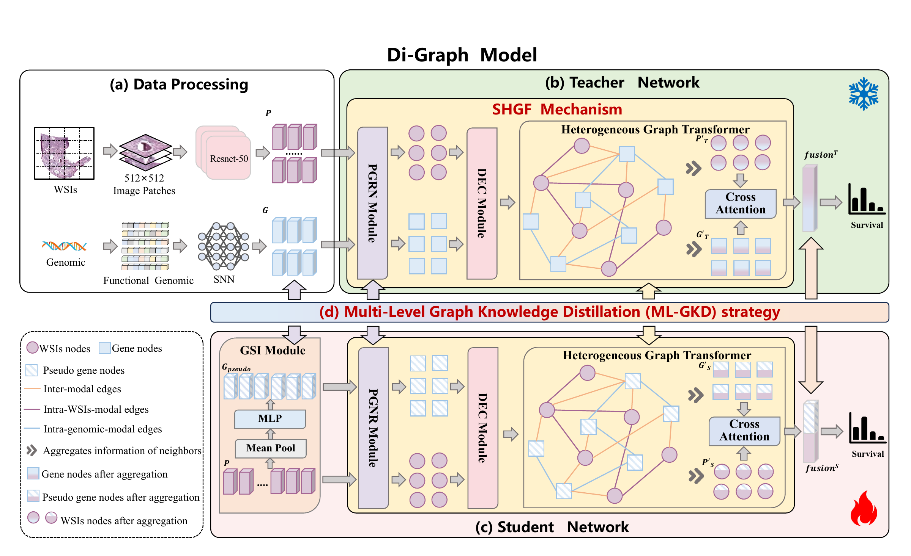

# Di-Graph

**Distilling Hierarchical Reasoning from Pathogenomic Graphs for Survival Analysis**

*Xinyu Liu, Leiye Liu, Miao Zhang, Yongri Piao, Weibing Sun, Feng Tian, Huan Bi, and Huchuan Lu.*

**Summary:** Di-Graph integrates pathology and genomic features through a structured heterogeneous graph and transfers the teacher's knowledge to a pathology-only student through multi-level graph knowledge distillation.



## Pre-requisites

Tested with Python 3.10, PyTorch 2.9.1, and PyG 2.6.1. Install a PyTorch build suitable for your CUDA environment and the dependencies:

```bash
pip install -r requirements.txt
```

## Prepare your data

### WSIs

1. Download diagnostic WSIs from [TCGA](https://portal.gdc.cancer.gov/).
2. Prepare non-overlapping **512 × 512 patches at 20× magnification**, as described in our paper. For WSI processing, please refer to [CLAM](https://github.com/mahmoodlab/CLAM). Extract **1024-dimensional ResNet-50 features** for each patch and save one `.pt` file per WSI. UNI features use 1024 dimensions, and CONCH features use 512 dimensions; set `--path_input_dim` accordingly. The network projects input features to 256 dimensions internally.

Organize WSI features as follows:

```text
DATA_ROOT_DIR/
└── pt_files/
    ├── slide_1.pt
    ├── slide_2.pt
    └── ...
```

`DATA_ROOT_DIR` is the base directory of a cancer cohort and is passed through `--data_root_dir`, as shown in [run.sh](run.sh).

### Genomics

In this work, we directly use the preprocessed genomic data provided by [MCAT](https://github.com/mahmoodlab/MCAT), stored in folder [dataset_csv_sig](dataset_csv_sig).

## Training-Validation Splits

We use patient-level 5-fold cross-validation with a 4:1 training-validation ratio. The original code reads split files from `splits/5foldcv/tcga_<CANCER_TYPE>/`, using `splits_0.csv` through `splits_4.csv`. Each file contains `train` and `val` columns of patient IDs. The study's split files are not distributed; place your split files in the same directory structure.

## Running Experiments

To train Di-Graph, update the feature paths and GPU IDs in [run.sh](run.sh), then run:

```bash
bash run.sh
```

Alternatively, specify the arguments directly:

```bash
CUDA_VISIBLE_DEVICES=<DEVICE_ID> python main.py \
    --which_splits 5foldcv \
    --split_dir tcga_<CANCER_TYPE> \
    --data_root_dir <DATA_ROOT_DIR> \
    --results_dir ./results/di_graph \
    --stage both \
    --max_epochs 40 \
    --path_input_dim 1024 \
    --alpha_layers 3 \
    --bag_loss nll_surv \
    --lr 0.0002 \
    --opt adam \
    --gc 32
```

`<CANCER_TYPE>` is one of `blca`, `brca`, `gbmlgg`, `luad`, or `ucec`. Use `--alpha_layers 5` for BRCA and GBMLGG, and 3 for the other cohorts. `--stage both` first trains the teachers across the requested folds, then trains the students using the saved teacher checkpoints. Individual stages can be selected with `--stage teacher` or `--stage student`.
